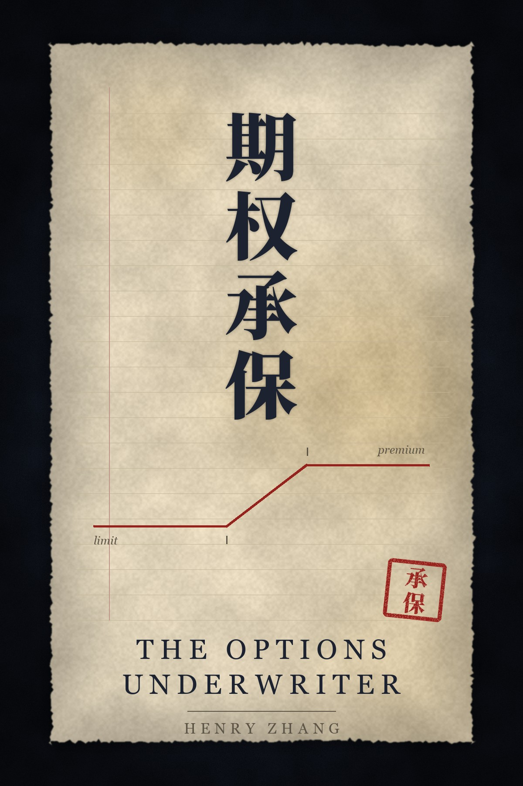

# The Options Underwriter · 期权承保

**Selling options read as running an insurance company: thirteen chapters on the policy, the price, the book, the claims, the reserves and the catastrophe, read against a single trade: the defined-risk credit spread.**

In 1688, in a coffee house by the Thames, merchants wrote their names under a ship's voyage and took a share of the loss if it sank. None of them knew which ship would go down. Every one of them knew, roughly, how many. They were not gamblers picking the ship that comes home. They were underwriters, paid for pricing a fleet.

Most people meet options as buyers: a cheap ticket and a hope. This book is about the other seat. The option seller writes a policy. He is paid a premium today to cover a move that may never come, in a size he chose, up to a limit he set, for a term printed on the ticket. He does not need to know where the market will go, only what moves usually cost and whether he is being paid more than that. And, like every insurer, he must still be open on the morning after the storm.

Numbered rules with a commentary, in the same format as [The Art of Options War](https://github.com/henryzhangpku/art-of-options-war). Different subject, different ideas: insurance instead of war. No forecasts, no signals, no performance claims.

## Read it

| | English | 中文 |
|---|---|---|
| Contents | **[Start here](en/README.md)** | **[从这里开始](zh/README.md)** |
| One file | [The whole book](en/the-whole-book.md) | [全书单页](zh/the-whole-book.md) |
| Prologue | [Before the First Policy](en/prologue.md) | [序：第一张保单之前](zh/prologue.md) |

### Or download the typeset edition

| | PDF | EPUB |
|---|---|---|
| English | [The Options Underwriter.pdf](https://pub-aa4f5218b3ce4b3abd876680f0ff5545.r2.dev/books/options-underwriter/The-Options-Underwriter.pdf) | [.epub](https://pub-aa4f5218b3ce4b3abd876680f0ff5545.r2.dev/books/options-underwriter/The-Options-Underwriter.epub) |
| 中文 | [期权承保.pdf](https://pub-aa4f5218b3ce4b3abd876680f0ff5545.r2.dev/books/options-underwriter/%E6%9C%9F%E6%9D%83%E6%89%BF%E4%BF%9D.pdf) | [.epub](https://pub-aa4f5218b3ce4b3abd876680f0ff5545.r2.dev/books/options-underwriter/%E6%9C%9F%E6%9D%83%E6%89%BF%E4%BF%9D.epub) |

Built from this same text, so the file and the repository cannot disagree. No email required for any of it. The same files are also attached to the [v1 release](https://github.com/henryzhangpku/options-underwriter/releases/tag/v1).

The Chinese edition is written for Chinese readers, paragraph for paragraph with the English, rather than translated word for word. Every rule, fact and number is the same in both.

## The thirteen chapters

| | | | |
|---|---|---|---|
| **Part I — The Policy** | 1. [The Policy](en/chapter-01.md) 《保单》 | 2. [The Price of Fear](en/chapter-02.md) 《恐惧的价格》 | 3. [Underwriting](en/chapter-03.md) 《核保》 |
| **Part II — The Book** | 4. [The Law of Large Numbers](en/chapter-04.md) 《大数法则》 | 5. [Accumulation](en/chapter-05.md) 《累积风险》 | 6. [Limits and Deductibles](en/chapter-06.md) 《限额与免赔额》 |
| **Part III — Claims and Capital** | 7. [Claims](en/chapter-07.md) 《理赔》 | 8. [Reserves](en/chapter-08.md) 《准备金》 | 9. [The Combined Ratio](en/chapter-09.md) 《综合成本率》 |
| **Part IV — Catastrophe and the Long Run** | 10. [Catastrophe](en/chapter-10.md) 《巨灾》 | 11. [Reinsurance](en/chapter-11.md) 《再保险》 | 12. [Float](en/chapter-12.md) 《浮存金》 |
| | 13. [The Hundred-Year Company](en/chapter-13.md) 《百年公司》 | | |

The order is the business: know what you sell, price it against what the market actually does, refuse what you cannot price, build a book instead of a bet, count the coasts, put a limit on every policy, pay claims early, keep reserves, measure the combined ratio, plan for the storm, insure yourself, respect the clock, and run a company that is still writing in twenty years.

## Read one chapter a day

Then read them again in order. The book is short on purpose: thirteen chapters, about a week and a half at one a day, and the second pass is where the order starts to do the work.

## A note on what this is

This book is education, not advice. It contains no recommendations for you personally, no signals and no promises. Options can lose money faster than stock. A defined-risk spread cannot lose more than its width, but its width can still be more than you can afford, and a run of them can still end an account. Insurers go bankrupt too; the ones that last are the ones that never forgot it. Nothing here is a performance claim; where the text names a number, the number is arithmetic you can check on paper.

## The author

Henry Zhang · 张恒 — [officialhenryzhang.com](https://www.officialhenryzhang.com)

The ideas the commentary rests on are the ones I actually trade: size over frequency, a limit on every position, one side first, hedge into a condor only when hurt, cut the short leg and keep the wing.

- **Also by the author** — [The Art of Options War · 期权兵法](https://github.com/henryzhangpku/art-of-options-war), the same trade read through Sun Tzu.
- **Henry Zhang Books on the App Store** — [the reading app](https://apps.apple.com/app/id6792229566), with the bilingual toggle.
- **Notes and letters** — [henryzhang.substack.com](https://henryzhang.substack.com/)

## Corrections and translations

Corrections are welcome — open an issue or a pull request. If you find a place where the arithmetic in the commentary does not check out on paper, that is the most useful issue you can file.

The chapter files in `en/` and `zh/` are generated from the edition in the Henry Zhang Books app, so the two never disagree about the text. An accepted correction is made at that source and the chapters are regenerated; a pull request against a chapter file is the place to point at the fix, not the place it lands.

Translations into other languages are welcome as forks; tell me and I will link yours from here.

## Licence

[Creative Commons Attribution-NonCommercial-NoDerivatives 4.0 International](LICENSE) (CC BY-NC-ND 4.0).

Free to read, free to share, free to quote with attribution. Not for sale, and not to be published in altered form. See [LICENSE](LICENSE).
